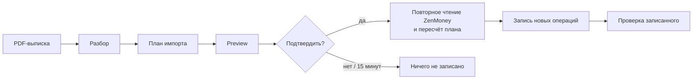

# Как устроен бот

!!! warning "Черновик"
    Описывает поведение до живой приёмки записи в ZenMoney; детали могут измениться.

## Поток данных

1. **Выписка.** Вы присылаете боту один или несколько PDF. Банк определяется по структуре файла, а не по названию в тексте.
2. **Разбор.** Отдельный парсер на каждый банк превращает строки таблицы в операции. Парсер должен доказать, что прочитал все строки и что они сходятся с итогами и остатками выписки; иначе импорт блокируется.
3. **План.** Бот читает ваш аккаунт ZenMoney и раскладывает операции: «к созданию», «уже есть», «дубли» (бот уже создавал их раньше), «вручную» и блокировки. Каждый счёт выписки сопоставляется со счётом ZenMoney только по явной записи в конфиге.
4. **Preview.** Вы видите план, список «Обработать вручную» и карточки переводов между своими счетами.
5. **Подтверждение.** Кнопка «Подтвердить (N)». Перед записью бот заново читает ZenMoney и пересчитывает план; если он изменился, ничего не пишется и приходит новый preview.
6. **Запись и проверка.** Операции отправляются порциями. После отправки бот перечитывает ZenMoney и проверяет, что всё на месте. Результат и номер импорта сохраняются в аудит-логе.

## Принципы безопасности записи

- **Dry-run по умолчанию.** Без `ZENBOT_WRITE_ENABLED=true` у процесса нет объекта записи в ZenMoney вообще.
- **Хэш плана.** Подтверждение относится к конкретному плану. Если между preview и подтверждением что-то изменилось (в ZenMoney появилась запись, пересчитался план), подтверждение не действует.
- **Fail-closed.** Неизвестный счёт, неизвестная валюта, непрочитанная строка, несходящийся остаток → остановка и объяснение, а не догадка. Запасного «основного счёта» нет.
- **Неоднозначное — вручную.** Если операция похожа на существующую или пару перевода можно выбрать несколькими способами, бот её не создаёт, а показывает в списке «вручную». Остальной план при этом можно записать.
- **Только создание.** Существующие операции не меняются и не удаляются, баланс не пишется.
- **Идемпотентность повторного импорта.** Id операции вычисляется из её данных в выписке и владельца аккаунта ZenMoney. Повторная загрузка той же или пересекающейся выписки не создаёт дублей: уже записанное попадает в «Дубли», создаётся только новое.
- **Переводы — только по решению.** Расход и приход на своих счетах объединяются в один перевод только после вашей кнопки.

## Компоненты

| Компонент | Что делает |
|---|---|
| Telegram-бот | Принимает файлы, показывает preview, списки и кнопки, отвечает на команды. Отвечает только владельцу. |
| Парсеры банков | Forte, Kaspi, Halyk: разбор PDF, проверка полноты строк и сверка с итогами выписки. |
| Сопоставление (matching) | Поиск дублей и похожих записей в ZenMoney, кандидаты в переводы между своими счетами, курсовые корректировки Kaspi. |
| Планировщик и writer | Строит план, считает его хэш, отправляет новые операции в ZenMoney после подтверждения и проверяет результат. |
| Клиент ZenMoney | Чтение и запись через diff API ZenMoney, с таймаутами и локальным ограничением частоты чтений. |
| Аудит-лог | Локальная база SQLite: что, когда и в каком импорте отправлено. Нужен для отката и для распознавания удалённых вами операций. |
| CLI | Импорт из JSON без Telegram, тоже dry-run по умолчанию ([CLI](cli.md)). |
